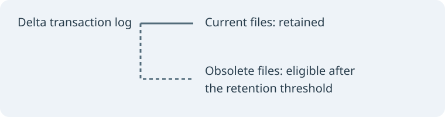

> Sample article: replace or remove this post when you publish your own work.

Delta Lake uses a transaction log to describe which data files belong to a table. Updates and deletes can leave older files behind; `VACUUM` removes files that are no longer needed and are older than the retention threshold.



## Before you clean up

Retention affects time travel and concurrent readers or writers. Choose a period longer than the longest-running transaction and the longest stream lag; removing files too early can break queries or streams. Check your platform's retention defaults and safety checks before changing them.

### Inspect first

On Databricks, use a dry run to list candidates before deleting them:

```sql
VACUUM events DRY RUN;
```

Then, when the retention policy is appropriate:

```sql
VACUUM events;
```

`VACUUM` is not a substitute for backups, and the ability to time travel depends on retaining both the necessary data files and transaction-log history. Behavior and options differ by runtime and table configuration; consult the [Databricks VACUUM documentation](https://docs.databricks.com/aws/en/delta/vacuum) and [Delta Lake utility documentation](https://docs.delta.io/latest/delta-utility.html#remove-files-no-longer-referenced-by-a-delta-table) before using it in production.
