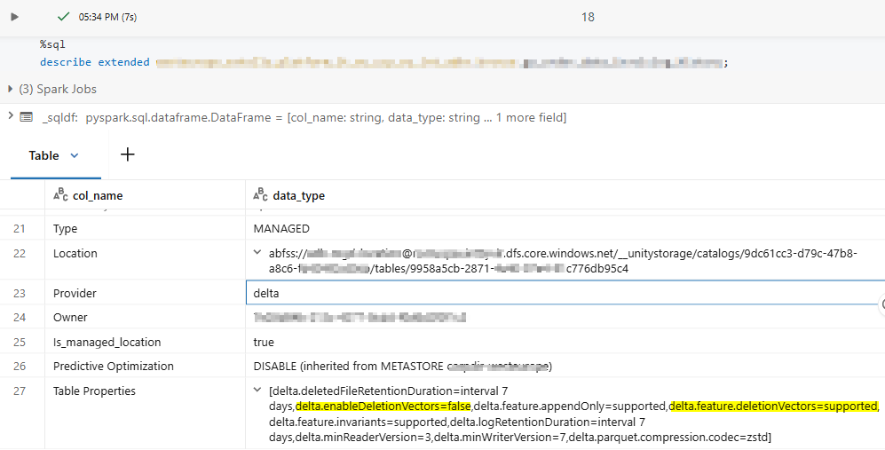
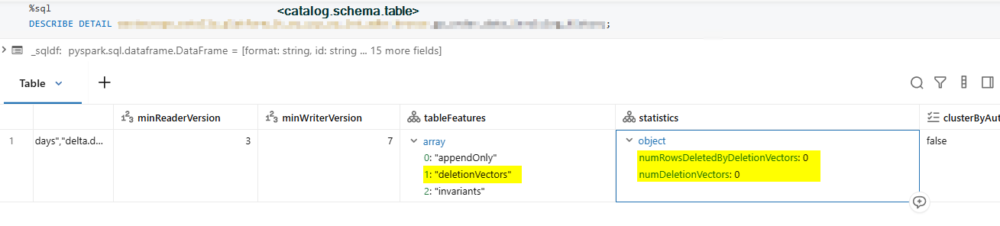

>This was the instruction: Let's enforce a 7-day retention policy on our tables. This not only implied blocking any consumer from doing time travel before the time window, but also that no physical file could retain a record for more than this period.


First things first was to check the state of the tables. With a describe command, it was seen that the vast majority of tables already had a 7-day configuration except a couple. For them we set the property `delta.deletedFileRetentionDuration` to the desired retention, and additional logic for the vacuum was also applied and executed.

When a deletion of a row occurs, its Parquet file that composes this version is recreated without that row, making the original file obsolete.

But being obsolete doesn't make it automatically disappear; it needs to be programmatically vacuumed. So when running the cleaning, VACUUM checks if the file is no longer **referenced** and has been obsolete for longer than the retention period.


>This is the ideal scenario! But something strange happens when some operations have a default feature enabled called **`Deletion Vectors`**

## Deletion Vectors

Delta Lake introduced this feature in version 2.3, and in later versions it was supported for DELETE, UPDATE and MERGE operations. When they occur, instead of creating a new Parquet file containing the change, Spark `may` mark the deleted rows in a bitmap, so when reconstructing the current state of the table Spark **may** use it to filter out the rows. This operation doesn't alter the original file, generally to avoid recreating files when the number of rows to be dropped is small.

But this comes with a catch, because if the original file is not obsolete after the deletion, then it never becomes a candidate for vacuuming.

### Inspect first

On Databricks, use a DESCRIBE EXTENDED on a table and you can see if this feature is enabled or not. Under table properties you can clearly see this feature is disabled (shown as false).

```sql
DESCRIBE EXTENDED catalog.schema.mytable;
```


If it were activated, with the details command you could inspect the deletion vector statistics shown below. In the example, no deletion vectors currently exist.

```sql
DESCRIBE DETAIL catalog.schema.mytable;
```




## How to deal with them

If we want to be strict with this, in our vacuum process we'll need to purge the deletion vectors and materialize the changes. We do that using this command:

```sql
REORG TABLE catalog.schema.table APPLY (PURGE); 
```

What this does is force Spark to take the deletion vectors and apply them to the Parquet files; hence the Parquet file is recreated, the original now becomes obsolete, and the clock starts ticking.

> So I do a REORG + PURGE and then the vacuum cleans it, right?

Well, actually no. The PURGE makes the original file obsolete, but it's at that very moment that the file becomes a candidate for vacuuming. The timing count is not retroactive, so it still needs to wait for the applicable VACUUM retention period before it can be dropped.

## Quick Fix

To cope with this we can ponder two options.

### A. Turn off the deletion vectors feature and purge any existing soft-deleted data before VACUUM

Set **`delta.enableDeletionVectors`** to false on each existing table and then apply a `REORG TABLE ... APPLY (PURGE)`.

### B. Shorten the file retention, accepting a shorter time-travel window.

Let's say that we want the files containing deleted rows to be deleted after 7 days. As we just saw, we first need to execute a REORG + PURGE to make them obsolete and eligible for vacuum. So what we can do then is apply a REORG + PURGE just before the VACUUM. So if there is a deletion vector, this will be reflected in an obsolete file. Say I run these two commands as a cleaning task (PURGE + VACUUM) every three days, and one file on DAY 2 suddenly has a deletion vector; on DAY 3 it becomes obsolete after the cleaning task. With a three-day retention period and successful runs every three days, this example would be vacuumed around day 6, considering that delays, failed runs, or time differences can extend this interval.


> ⚠️ This scenario can be problematic if we execute the vacuum while jobs are working with the data. If one job modifies a file that another job is still using and the vacuum deletes it, the job can fail. To be on the safe side, schedule a VACUUM separately and choose a retention period longer than the longest running transaction and the maximum lag of any stream.


Seguimos!
