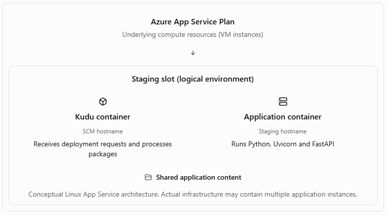
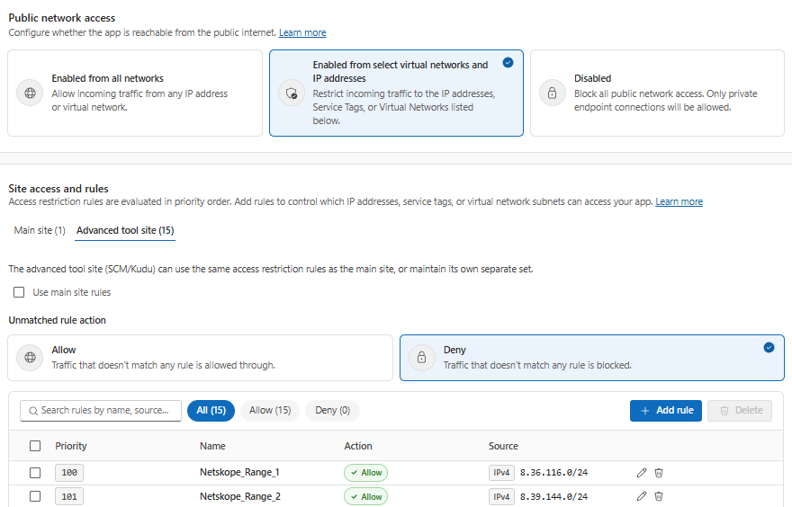
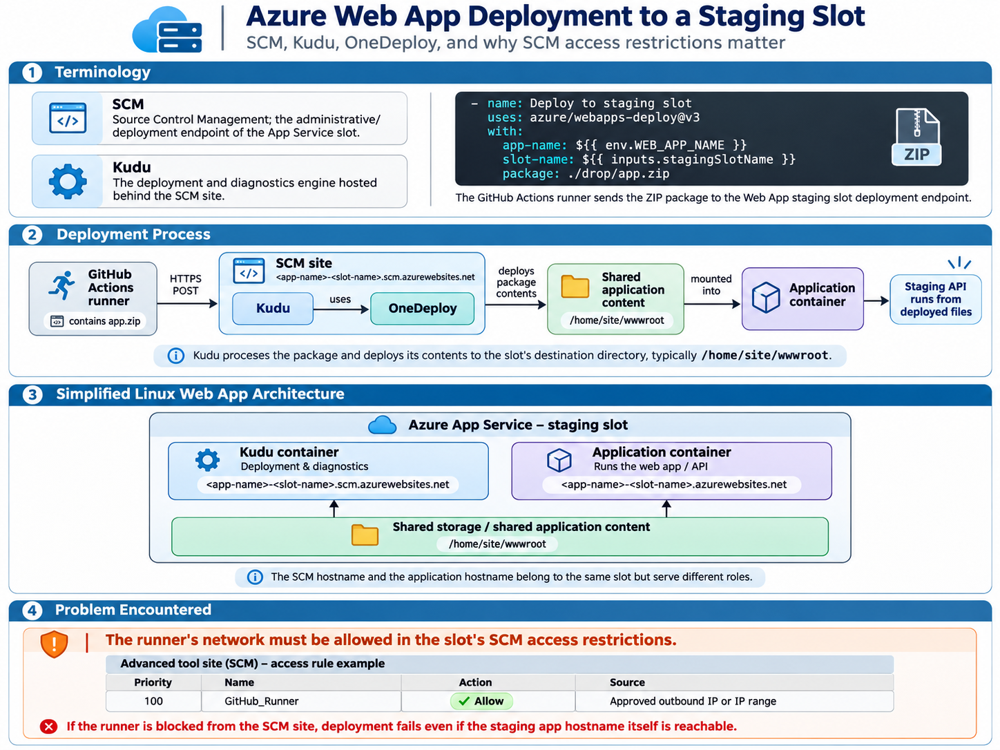

---
title: "Journal: azure/webapps-deploy@v3 networking deploy incident"
date: 2026-11-04
description: "Github runner not reaching the SCM hostname"
tags: [Azure, App Service, Networking]
categories: [Cloud]
draft: false
---


## Terminology

SCM: Source Control Management

Kudu: A deployment and diagnostics engine.

While deploying to Azure Web App resources, I came across the **azure/webapps-deploy@v3** action with the following configuration:

```yaml
      - name: Deploy to staging slot
        uses: azure/webapps-deploy@v3
        with:
          app-name: ${{ env.WEB_APP_NAME }}
          slot-name: ${{ inputs.stagingSlotName }}
          package: ./drop/app.zip
```

This JavaScript/TypeScript action takes the application package (a ZIP file) available on the GitHub Actions runner and sends it to the Web App slot.

## Deployment Process

The runner sends the ZIP file in an HTTP POST request to the slot's SCM site. This site hosts Kudu, the software that receives deployment requests. Kudu uses OneDeploy to process the package and deploy its contents to the slot's destination directory, typically `/home/site/wwwroot`.

## Simplified Linux Web App Architecture

A Kudu container has its own hostname, typically `<app-name>-<slot-name>.scm.azurewebsites.net` for a deployment slot.

The application container has a default slot hostname, typically `<app-name>-<slot-name>.azurewebsites.net`.

Shared storage makes the deployed application files available to the application container.



## Problem Encountered

The runner's network needs to be allowed in the "Advanced tool site (SCM)" access restrictions section. An example rule is:

Priority: `100`

Name: `GitHub_Runner`

Action: Allow

Source: The runner's approved outbound IP address or IP range.



Below you'll find an infographic summarizing the incident:

