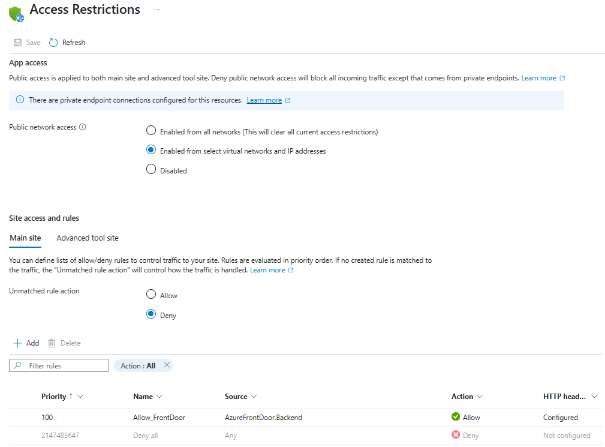
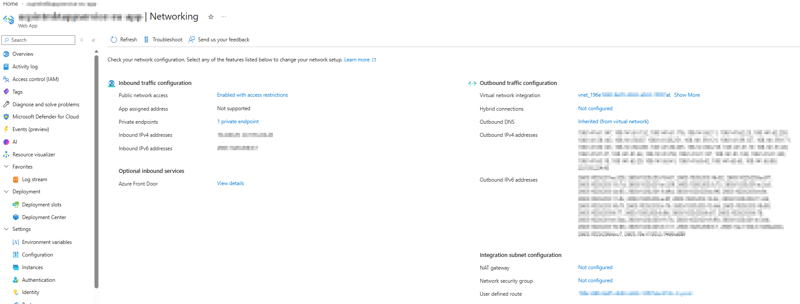
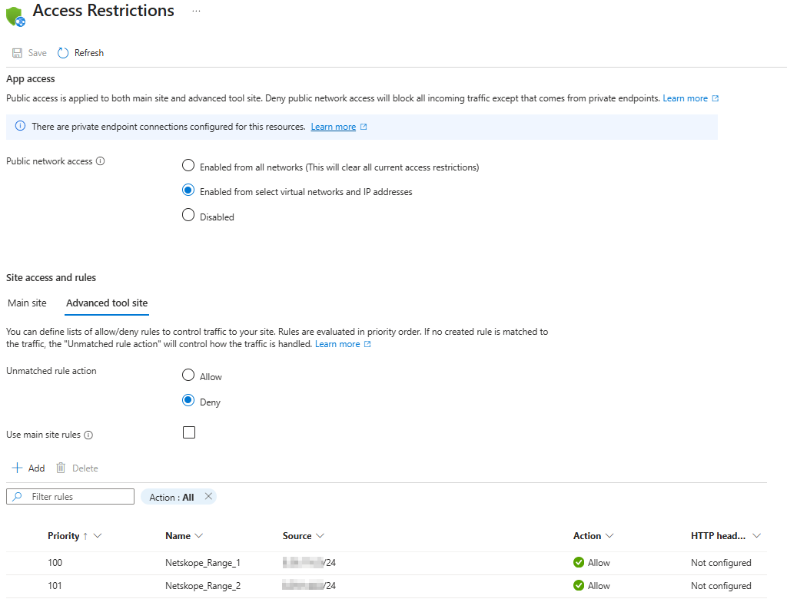

## Key takeaway

This App Service has **restricted public access and a private endpoint**. Its public application endpoint allows matching Azure Front Door traffic, while its public administration endpoint allows two configured IP ranges. Separately, VNet integration gives the application an outbound path into a virtual network.

These screenshots show configuration, not a successful connectivity test. Blurred addresses, hidden header values, private endpoint approval, DNS records, and routing details cannot be verified from them.

## Picture 1 — Main site access restrictions



The **main site** is the endpoint serving your application, typically `https://<app>.azurewebsites.net` and any custom domains mapped to it. These rules decide which requests can reach it through the public App Service endpoint.

| Setting in the picture | Meaning for this app |
| --- | --- |
| Public network access: **Enabled from select virtual networks and IP addresses** | The public endpoint remains enabled, but access restrictions filter incoming requests. This selection does not, by itself, create a VNet connection. |
| Private endpoint connections banner | A private endpoint connection exists. It provides a separate private inbound path, subject to approval, routing, and DNS being correct. |
| Unmatched rule action: **Deny** | Requests that match no allow rule are rejected at the App Service network access layer, normally with HTTP 403. |
| Priority **100**, `Allow_FrontDoor` | Azure evaluates smaller priority numbers first. This is the visible explicit allow rule. |
| Source: **AzureFrontDoor.Backend** | This service tag represents the address ranges Front Door uses to connect to origins. It is not your visitors' original IP range. |
| HTTP headers: **Configured** | The rule also has a header condition. A request must satisfy the source and configured header conditions to match. The picture does not show the header name or value. |
| `Deny all`, priority **2147483647** | The final fallback denies traffic that did not match an earlier rule. It reflects the deny-by-default behavior. |

### Why Front Door and a header filter are used together

The expected public flow is:

```text
Visitor -> Azure Front Door -> App Service public endpoint -> Application
                                 |
                                 +-- source and header must match the allow rule
```

The service tag covers Front Door infrastructure shared across customers. On its own, it does not identify your particular Front Door profile. A common additional filter is `X-Azure-FDID` set to your Front Door ID; open the rule to verify whether that is the actual configured header and value here.

An ordinary visitor going directly to the app's public hostname should be denied by the shown rules. A request through Front Door is allowed only when it matches the full rule. Network permission still does not replace application authentication or authorization.

**Private endpoint distinction:** App Service access restriction rules do not evaluate traffic arriving through a private endpoint. Therefore, the main-site Front Door rule does not require private callers to use Front Door. Private connectivity and application authentication determine whether those callers can use the app.

## Picture 2 — Networking overview



Read the left side as **connections coming into the app** and the right side as **connections the app initiates**. A private endpoint and VNet integration serve different directions.

### Inbound traffic configuration

| Setting in the picture | Meaning |
| --- | --- |
| Public network access: **Enabled with access restrictions** | A summary of the public filtering shown in pictures 1 and 3. The app is not private-only. |
| App assigned address: **Not supported** | The dedicated app-assigned inbound address feature is unavailable for this setup. This does not mean that the app has no inbound IP address or cannot receive traffic. |
| Private endpoints: **1 private endpoint** | A private endpoint exposes the app through a private IP in a VNet. The count alone does not confirm approval, working name resolution, or client reachability. |
| Inbound IPv4 / IPv6 addresses | Addresses associated with the public inbound endpoint. They are blurred here. Use the app's HTTPS hostname; knowing an IP does not bypass access restrictions. |
| Azure Front Door: **View details** | The portal exposes Front Door details for the app. Inspect that configuration to confirm the origin, origin connectivity mode, health probes, and any WAF policy. This overview does not establish those settings. |

For private access, a client needs a network route to the endpoint and DNS that resolves the application hostname to the private endpoint IP. Typically, App Service private DNS uses `privatelink.azurewebsites.net`. Continue using the normal app hostname for HTTPS so host routing and certificate validation work correctly.

### Outbound traffic configuration

| Setting in the picture | Meaning |
| --- | --- |
| Virtual network integration: **a VNet is selected** | The app can send traffic into the integration subnet to reach resources available through that network. This does not provide private inbound access to the app. |
| Hybrid connections: **Not configured** | No App Service Hybrid Connections are configured. This feature can provide access to specific TCP host-and-port destinations; VNet integration is a separate mechanism. |
| Outbound DNS: **Inherited (from virtual network)** | The app uses the DNS configuration associated with the integrated VNet. Actual private-name resolution depends on the configured DNS servers, zone links, and forwarding. |
| Outbound IPv4 / IPv6 addresses | Public egress addresses reported for App Service. The source address a destination actually sees depends on the route and any NAT or firewall in that path. Do not assume every outbound connection uses every listed address. |

**VNet integration does not prove that all internet traffic goes through the VNet.** Outbound routing settings determine which traffic enters it. Check the app's outbound internet routing / Route All setting before concluding that a firewall or route table controls all egress.

### Integration subnet configuration

| Setting in the picture | Meaning |
| --- | --- |
| NAT gateway: **Not configured** | No NAT gateway is associated with the integration subnet. The screenshot therefore does not show a NAT-gateway-based fixed public egress IP. Another device, such as a firewall, could still translate routed traffic. |
| Network security group: **Not configured** | No NSG is associated with this integration subnet. This does not describe controls on other subnets or application-level controls. |
| User defined route: **a linked resource is shown** | A route table is associated with the integration subnet. Its routes and next hops are hidden, so the picture cannot establish which traffic is sent to a firewall, appliance, or other destination. |

The private endpoint subnet and the integration subnet have separate roles. The subnet settings shown here describe **outbound integration**, not necessarily the subnet hosting the private endpoint.

## Picture 3 — Advanced tool site access restrictions



The **advanced tool site**, also called **SCM/Kudu**, is the App Service management and deployment endpoint, typically `https://<app>.scm.azurewebsites.net`. Depending on the app environment, it supports deployment APIs, diagnostics, logs, and troubleshooting tools.

| Setting in the picture | Meaning for this app |
| --- | --- |
| Public network access: **Enabled from select virtual networks and IP addresses** | The app-level public-access setting applies to both the main site and SCM. Each can still have its own restriction rules. |
| **Use main site rules** is unchecked | SCM uses its own rules rather than inheriting the main site's Front Door allow rule. |
| Unmatched rule action: **Deny** | Public SCM requests outside the matching allow rules are rejected. |
| Priority **100**, `Netskope_Range_1`, **Allow** | Permits public SCM requests whose source IP falls in the first configured CIDR range. |
| Priority **101**, `Netskope_Range_2`, **Allow** | Permits public SCM requests whose source IP falls in the second range. The first rule is evaluated before this one. |
| Sources ending in **/24** | Each IPv4 range contains 256 addresses. For example, `203.0.113.0/24` spans `203.0.113.0` through `203.0.113.255`; this is an illustrative range, not the blurred configured value. |
| HTTP headers: **Not configured** | These two rules do not add HTTP header matching conditions. Their visible restriction is the source IP range. |

The rule names suggest corporate Netskope egress ranges, but names are labels: Azure checks the actual source IP, not whether a device runs Netskope. A developer or deployment agent must emerge from an allowed range to use the **public** SCM endpoint. Being connected to a corporate network is insufficient if that request uses a different egress IP.

Passing a network rule does not grant deployment privileges. SCM authentication and deployment authorization still apply. Conversely, valid deployment credentials cannot bypass a network denial.

Private SCM access requires private routing and appropriate SCM DNS resolution, commonly an additional `<app>.scm` record in the App Service private DNS zone. The screenshots do not show those records. As with the main site, public access restriction rules do not filter requests arriving through the private endpoint.

## How the three pictures fit together

```text
PUBLIC APPLICATION ACCESS
Visitors -> Front Door -> main site public endpoint
                         Allowed only when source + header conditions match

PUBLIC ADMINISTRATION / DEPLOYMENT
Developer or CI agent -> allowed egress IP range -> SCM public endpoint
                                                  Authentication still required

PRIVATE INBOUND ACCESS
Client with private routing + DNS -> private endpoint -> app / SCM
                                    Public access rules do not filter this path

OUTBOUND APPLICATION ACCESS
App -> VNet integration subnet -> reachable private resources
                              -> other destinations according to routing settings
```

These are possible paths supported by the visible configuration, not confirmation that every path is operational. In particular, the existence of both Front Door and a private endpoint does not prove that Front Door uses that private endpoint; inspect the Front Door origin's Private Link settings to establish that.

### Expected outcomes

| Request | Expected network result from the shown settings |
| --- | --- |
| Internet user directly accesses the main site's public hostname | Denied unless it matches the Front Door source and header conditions. |
| Front Door sends a request matching the main site's entire allow rule | Allowed by the shown access restriction; application behavior and other controls still apply. |
| Developer accesses public SCM from either configured IP range | Allowed by the shown SCM rules; authentication is still required. |
| CI agent accesses public SCM from an unrelated public IP | Denied, even with valid credentials. |
| Client reaches the app through the private endpoint | Public access restriction rules do not apply; connectivity and authentication still need to work. |
| App calls a private database through the integrated VNet | Potentially reachable; DNS, routes, destination firewall rules, and database authorization must permit it. |

## Details to inspect to complete the picture

1. Open `Allow_FrontDoor` and check the exact HTTP header filter, especially whether `X-Azure-FDID` identifies the intended Front Door profile.
2. Inspect the private endpoint's approval state, target subresource, subnet, and private DNS records for both the app and SCM.
3. Check the actual Netskope-named CIDR values against the source IP used by developer browsers and deployment agents.
4. Inspect VNet integration routing settings and the associated route table's prefixes and next hops before describing the outbound firewall path.
5. Check the Front Door origin connection mode and health, and inspect WAF settings separately. None of these screenshots confirms that a WAF is enabled.

## Microsoft documentation

These references explain the Azure mechanisms discussed above; the configuration observations come from the three screenshots.

- [App Service access restrictions](https://learn.microsoft.com/en-us/azure/app-service/app-service-ip-restrictions) — rule priority, service tags, HTTP header filters, and SCM restrictions.
- [App Service private endpoints](https://learn.microsoft.com/en-us/azure/app-service/overview-private-endpoint) — private inbound connectivity, DNS, SCM records, and interaction with access restrictions.
- [App Service VNet integration](https://learn.microsoft.com/en-us/azure/app-service/overview-vnet-integration) — outbound connectivity and integration subnet behavior.
- [Manage App Service VNet integration routing](https://learn.microsoft.com/en-us/azure/app-service/configure-vnet-integration-routing) — which outbound traffic enters the VNet.
- [Secure traffic to Azure Front Door origins](https://learn.microsoft.com/en-us/azure/frontdoor/origin-security) — restricting origins using Front Door source addresses and identity headers.
