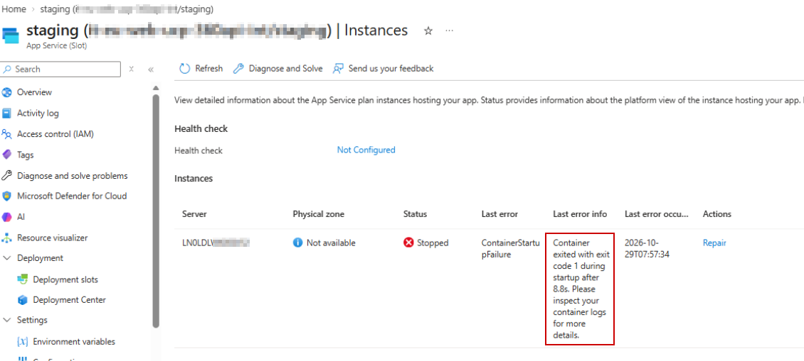
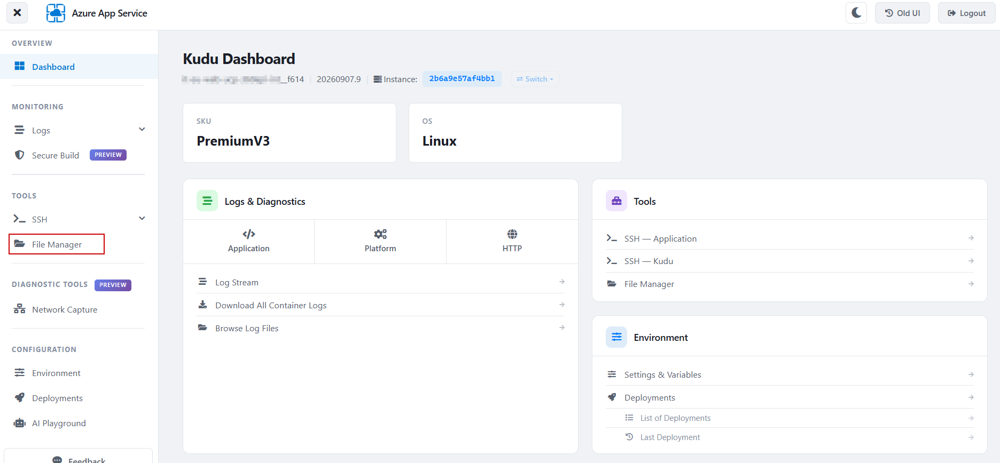
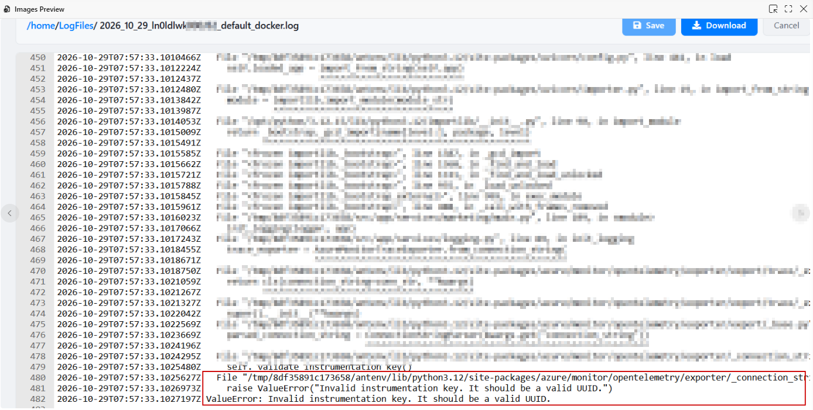

## The error

The Azure Web App showed this error today:

It looks like there was a problem in the container, so let's look directly at Development Tools → Advanced Tools 🪛

There we can go to an Azure App Service UI which has Kudu's File Manager in the Tools section, where we can inspect the container logs under `/home/LogFiles/`.

Then we click on File Manager. You can see in this renovated UI a list of files generated per instance at every app deploy. To see the one that matters to us, let's inspect the ones containing "_docker.log" or "_default_docker.log" in their name. Also, you may choose the ones tagged with **`CURRENT INSTANCE`** or the others if your error refers to a past deploy. Note ⚠️ Scaled-out apps can have a separate set of logs per instance; in this example we are seeing only one.

Since we want to identify the error, it will likely appear in the _default_docker.log because it shows the stdout and stderr logs.

As we can see, it now shows the error.

## Terminology

As a summary, these are one-line descriptions for the types of logs shown.

- **`_docker.log`** = **platform/container lifecycle log**.
- **`_default_docker.log`** = **your app container stdout/stderr log**.
- **`_default_scm_docker.log`** = the **SCM/Kudu-side container log**, not your main app container.

Also, remember that Kudu is a diagnostic service for an Azure App Service app. In our case it provides an interface to find the container logs. This service also runs in a separate container, which is why we have the _scm_docker.log, which is distinct from the container log.
